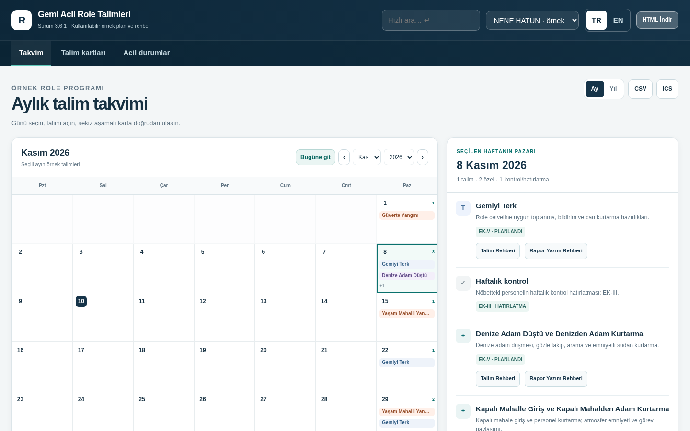
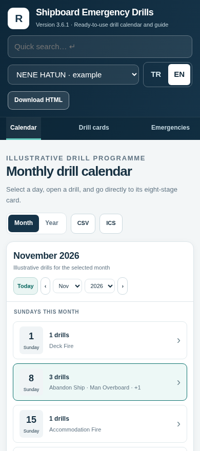
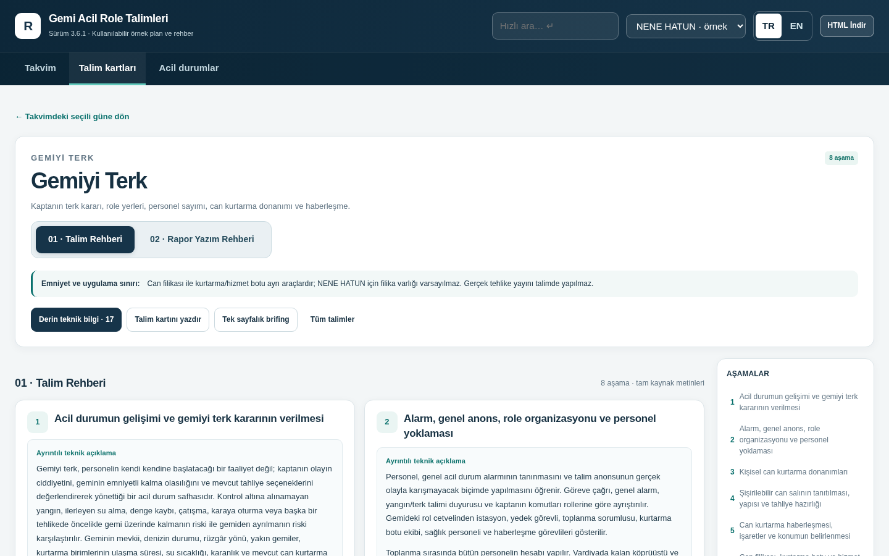
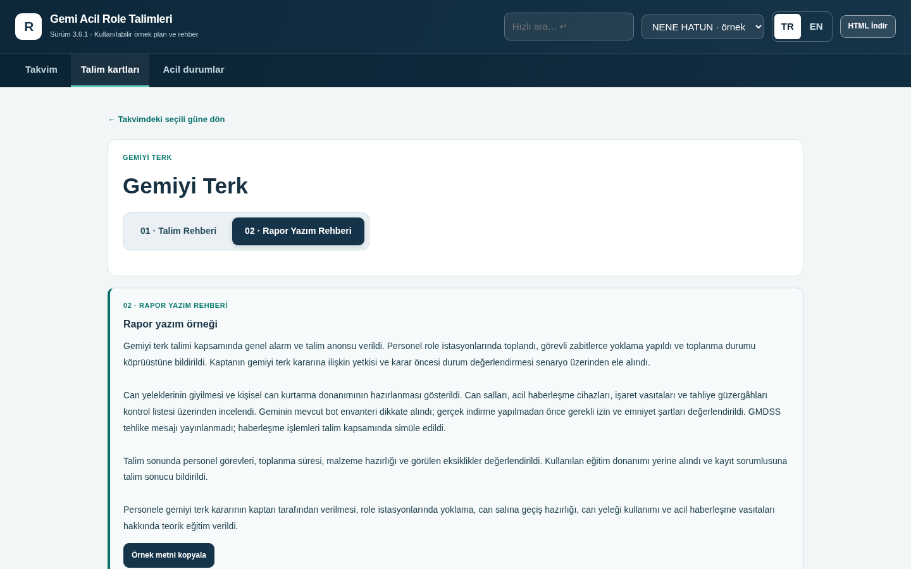

# Gemi Acil Role Talimleri | Shipboard Emergency Drills

## Türkçe

**Gemi Acil Role Talimleri**, gemi zabitlerinin örnek role talim programını hızlıca inceleyebilmesi, talimleri hazırlayabilmesi ve ilgili teknik eğitim bilgilerine erişebilmesi için hazırlanmış iki dilli bir takvim ve rehber uygulamasıdır.

Açılışta **aylık talim takvimi** görüntülenir. Bir tarih seçildiğinde o güne ait talimler, özetleri ve doğrudan rehber bağlantıları gösterilir. Her talimde sekiz aşamalı uygulama açıklamaları, teknik bilgi notları, **02 · Rapor Yazım Rehberi** ve yazdırılabilir brifing bulunur. Acil durum başvuru bölümü ve yıllık takvim de aynı arayüzden erişilebilir.

Uygulama **Türkçe ve İngilizce** kullanılabilir; NENE HATUN örnek profili ile genel gemi profili arasında seçim yapılabilir. Temel uygulama tek bir HTML dosyasıdır; kuruluma veya internet bağlantısına ihtiyaç duymaz.

**Erişim ve indirme**

- [**Güncel uygulamayı aç — v3.6.1**](https://bemiroglu.github.io/gemi-acil-role-talimleri/)
- [**Güncel tek HTML dosyasını indir — v3.6.1**](https://github.com/bemiroglu/gemi-acil-role-talimleri/raw/refs/heads/main/index.html)
- [**Tam paket — HTML ve ayrı kaynak arşivi (ZIP)**](https://github.com/bemiroglu/gemi-acil-role-talimleri/raw/refs/heads/main/downloads/Gemi_Acil_Role_Talimleri_v3.6.1_Tam_Paket.zip)
- [**Özgün v1.7.0 sürümünü aç**](https://bemiroglu.github.io/gemi-acil-role-talimleri/versions/v1.7.0/)
- [**Özgün v1.7.0 HTML dosyasını indir**](https://github.com/bemiroglu/gemi-acil-role-talimleri/raw/refs/heads/main/versions/v1.7.0/index.html)

### Ekran görüntüleri

**Aylık takvim ve seçilen haftanın talimleri**

**Mobil takvim**

**Talim Rehberi**

**Rapor Yazım Rehberi**

---

## English

**Shipboard Emergency Drills** is a bilingual calendar and technical guide designed to help deck and engineering officers review example drill schedules, prepare exercises, and locate relevant emergency training guidance quickly.

The app opens with a **monthly drill calendar**. Select a date to see the planned drills, short descriptions, and direct links to their guidance. Each drill includes eight structured training stages, technical learning notes, a **Reporting Guide** with example past-tense narrative, and a printable briefing. An emergency reference library and annual calendar are also available.

Use the application in **Turkish or English**, with a NENE HATUN example-vessel profile or a generic-vessel profile. The core app is a single standalone HTML file that works offline without installation.

**Open and download**

- [**Open current application — v3.6.1**](https://bemiroglu.github.io/gemi-acil-role-talimleri/)
- [**Download standalone HTML — v3.6.1**](https://github.com/bemiroglu/gemi-acil-role-talimleri/raw/refs/heads/main/index.html)
- [**Complete package — HTML and separate source archive (ZIP)**](https://github.com/bemiroglu/gemi-acil-role-talimleri/raw/refs/heads/main/downloads/Gemi_Acil_Role_Talimleri_v3.6.1_Tam_Paket.zip)
- [**Open original v1.7.0**](https://bemiroglu.github.io/gemi-acil-role-talimleri/versions/v1.7.0/)
- [**Download original v1.7.0 HTML**](https://github.com/bemiroglu/gemi-acil-role-talimleri/raw/refs/heads/main/versions/v1.7.0/index.html)

The screenshots above illustrate the monthly calendar, mobile agenda, drill guidance, and reporting guide.
